

# 👋 Hi, I'm Habtamu Teklehaymanot

### Computer Engineering Student at Bahir Dar University 🇪🇹

---

## 🧑‍💻 About Me

I enjoy web development, working with databases and turning ideas into working projects. Mathematics and problem-solving shape the way I approach programming. Outside of code, I'm a singer 🎤.

🤝 **Open to:** internships, collaboration and freelance work.

## 🚀 Projects

### 🎓 University Student Management System
A system designed to organize and manage student information and academic records.

  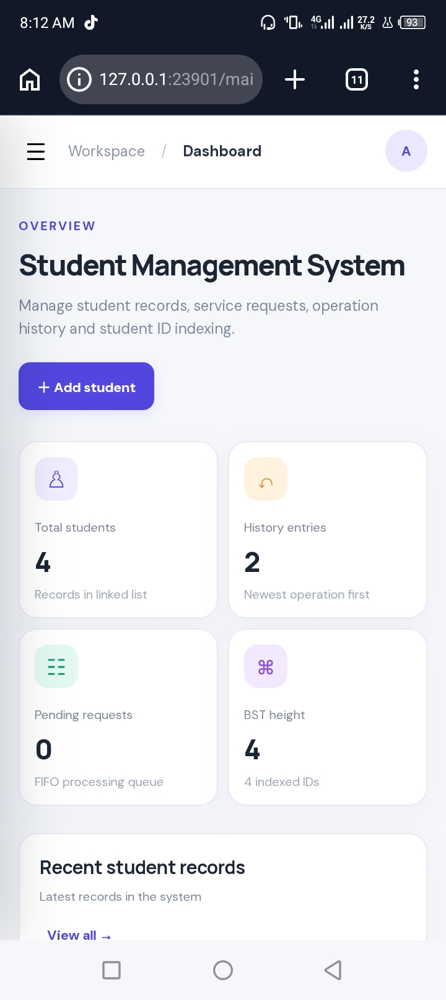
  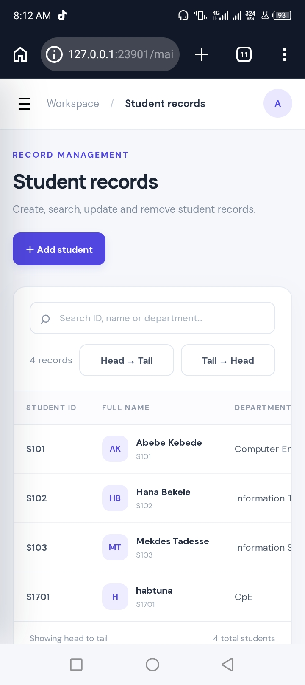
  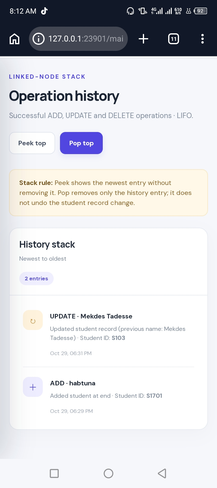

### 📝 Personal Notes Management Web Application
A web application for creating, organizing and managing personal notes.

  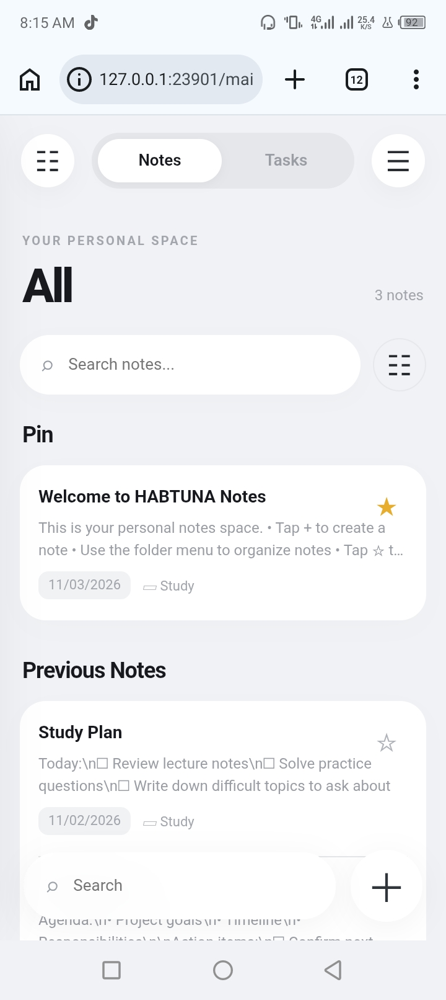
  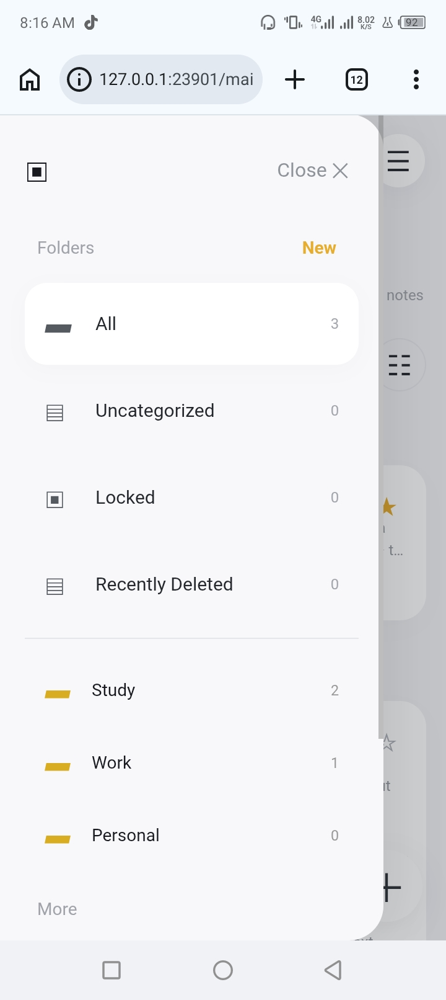
  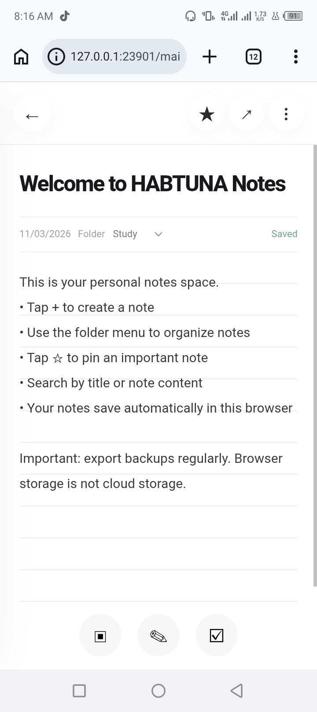

### 🗂️ Student Management System (Data Structures)
An academic **C++** project that organizes and manipulates student information using data structures.

  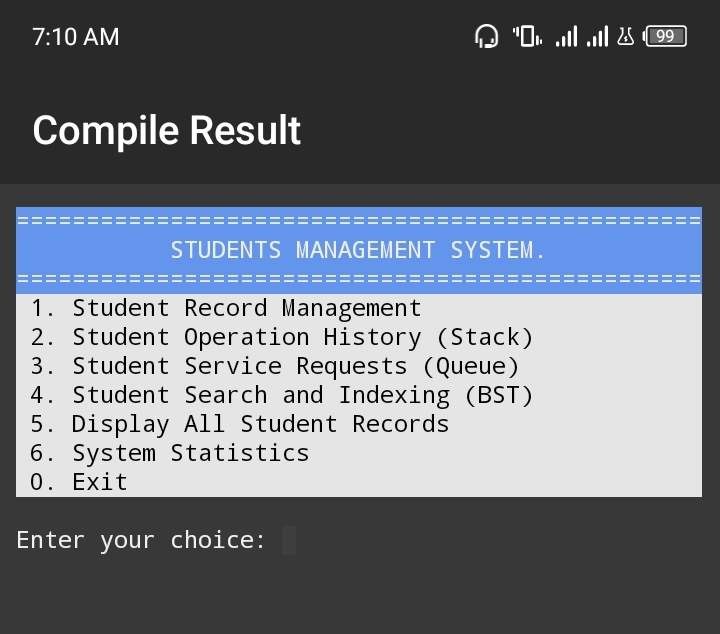
  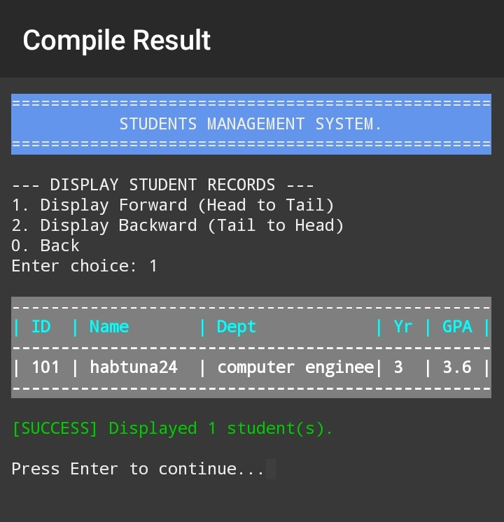

### 💊 Easy-Pharma Inventory System
Our second-year **Intermediate Programming (C++)** course project. It uses file handling to save records permanently.

  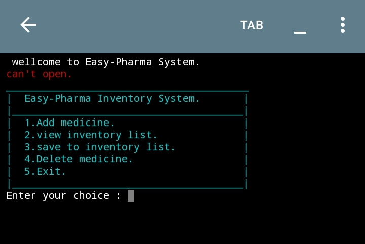
  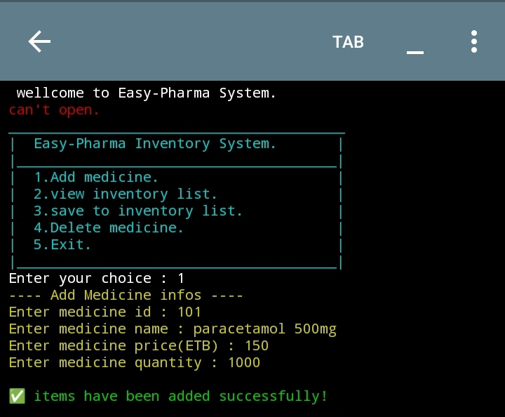

### 🏥 SmartCare Ethiopia
A web-based version of my Easy-Pharma console app. I rebuilt it to make it more visual and interactive.

  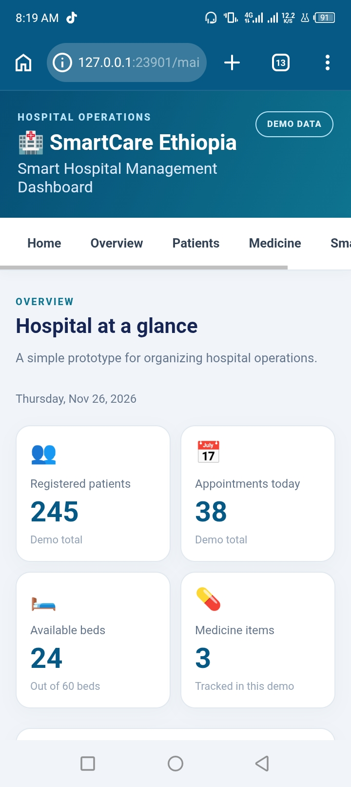
  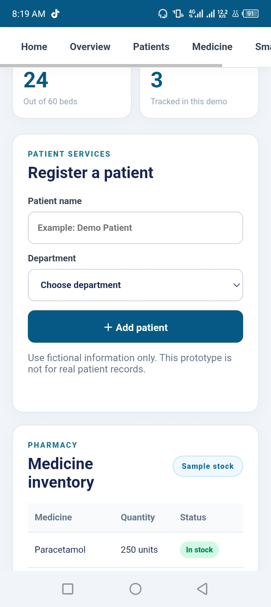
  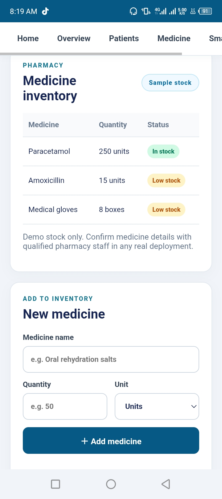

## 🛠️ Technical Skills

| Area | Skills |
|------|--------|
| **Frontend** | HTML, CSS, JavaScript |
| **Backend** | Node.js |
| **Databases** | SQL, Microsoft SQL Server, SQLite |
| **Programming** | C++ |
| **Tools** | Git, GitHub, Termux |
| **Concepts** | Data structures, algorithms, database design, ER diagrams, problem-solving |

## 🌱 Currently Learning

Advanced JavaScript • Backend development • Database management • Data structures and algorithms • Software engineering • Application development

## ✨ Portfolio Features

- 📱 Layout for phones and desktops
- 🌙 Dark and light themes
- 🖼️ Swipeable project image galleries
- 🔍 Project filtering by technology
- 📄 CV download
- ✉️ Contact section

This website is built with **HTML5**, **CSS3** and **vanilla JavaScript**.

## 📬 Contact

📧 [hteklye005@gmail.com](mailto:hteklye005@gmail.com)

---

⭐ **Thanks for visiting my portfolio!**

